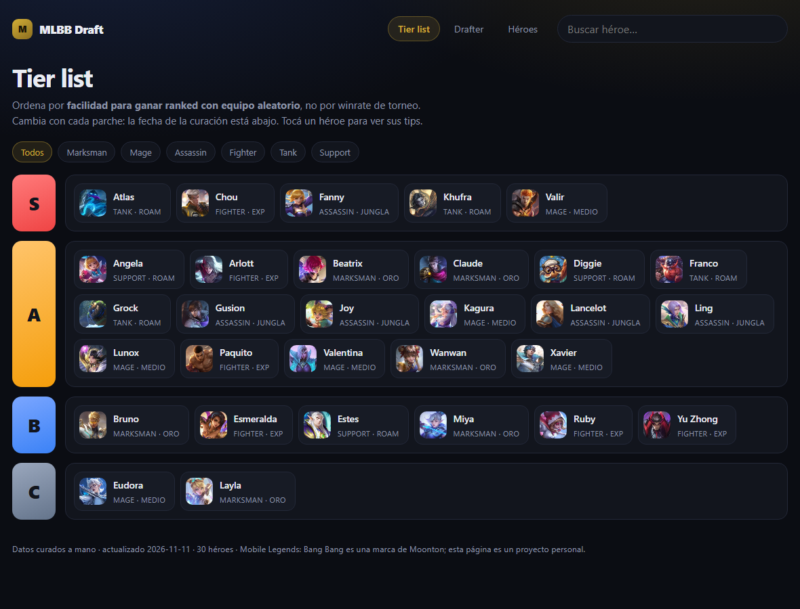
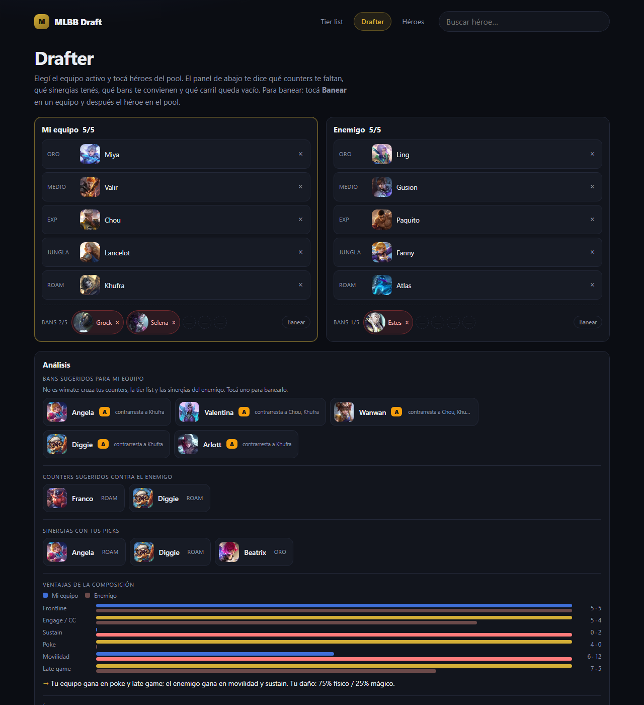
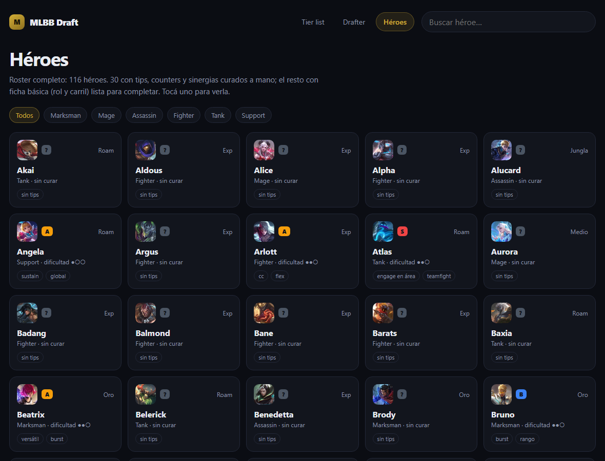
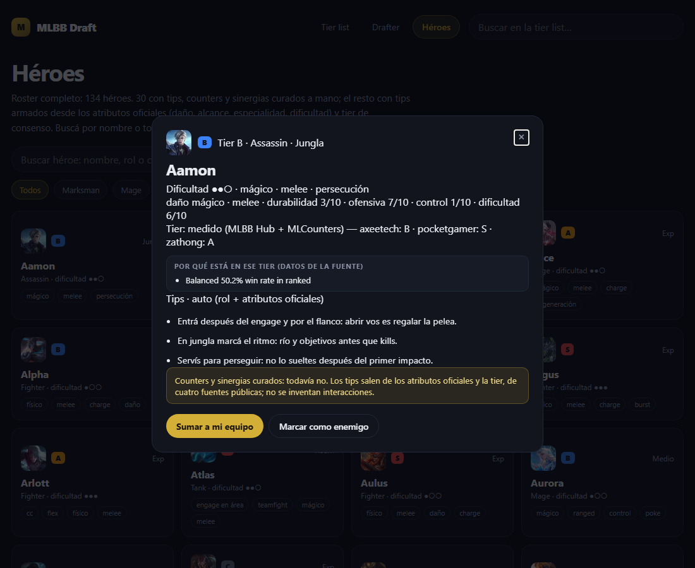
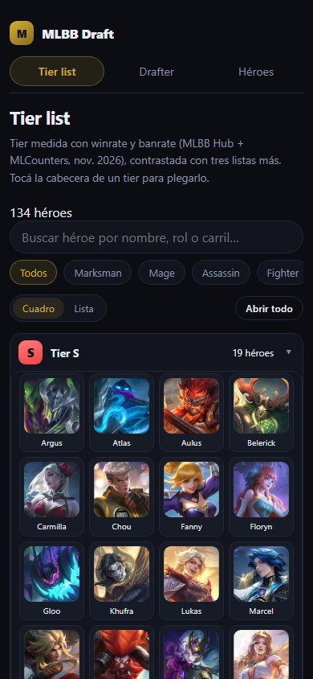

# MLBB Draft

[](https://github.com/lucabaello1998/mlbb-draft/releases/latest)

**Tier list, drafter de 5v5 y tips por héroe para Mobile Legends: Bang Bang.** Sin cuenta, sin app y
sin instalar nada: abre en el celular o en la compu y arma la composición.

**→ <https://lucabaello1998.github.io/mlbb-draft/>**



| Drafter | Héroes | Ficha |
|---|---|---|
|  |  |  |

## Qué hace

### Tier list

S/A/B/C por héroe, con filtro por rol y buscador. La tier **no es una opinión suelta**: sale de una
lista medida con winrate y banrate, contrastada con tres listas públicas (noviembre 2026). Cada ficha
muestra qué letra dio cada fuente:

| Fuente | Qué aporta |
|---|---|
| [AxeeTech](https://axeetech.com/mlbb-hero-tier-list/) | **Fuente principal**: 133 héroes con winrate y banrate medidos (cruza MLBB Hub y MLCounters) |
| [Pocket Gamer](https://www.pocketgamer.com/mobile-legends-bang-bang/tier-list/) | Corroboración: tablas por rol, S+ a D |
| [Zathong](https://zathong.com/mobile-legends-tier-list/) | Corroboración: tabla general, S+ a D |
| [Esports.net](https://www.esports.net/wiki/guides/mlbb-tier-list/) | Corroboración (más vieja: febrero 2026) |

S+ se muestra como S y D como C, para no abrir seis filas. Los 30 héroes curados a mano conservan su
tier. **Un héroe que ninguna fuente lista queda en "?" con el motivo escrito** (hoy: Dori, que salió
después de las listas). Preferimos eso a inventarle una letra.

La vista arranca en **modo cuadro** (retratos en grilla, nombre abajo) y se puede cambiar a **lista** con
rol y carril. Cada tier se **pliega** con un toque en su cabecera: por defecto abren S y A, y B/C/? quedan
cerrados para que la página no sea un scroll eterno. El modo y los tiers abiertos se recuerdan en el
navegador. En el celular la grilla pasa a 4 columnas y el encabezado queda fijo.



La ficha también trae lo que las fuentes midieron ("54.6% win rate in ranked"), con el texto original.

### Drafter

- Dos equipos de 5 con los carriles reales (Oro, Medio, Exp, Jungla, Roam).
- **Arrastrar y soltar**: agarrás un héroe del pool y lo soltás en el carril que quieras, o en la fila de
  bans. Mientras arrastrás, todas las zonas válidas se marcan; la que está debajo del dedo se resalta.
  Se puede arrastrar también un héroe ya puesto, de un carril a otro.
- **Tocar sigue funcionando** (es la alternativa accesible que pide WCAG 2.5.7): tocás un carril vacío y
  después un héroe, y cae ahí; si no tocaste ningún carril, cae en el primero libre del equipo activo.
- En el celular el arrastre arranca con una **pulsación sostenida de 220 ms**, para no pelearse con el
  scroll; con el mouse arranca a los 6 px. `Escape` cancela, y el lector de pantalla anuncia cada
  movimiento con una región `aria-live`.
- **Bans**: 5 por equipo. Arrastrás el héroe a la fila de bans, o usás *Banear* y después lo tocás; el
  baneado sale del pool y se ve con su retrato. Se saca con la ×.
- **Bans sugeridos**: cinco candidatos para tu equipo, con el motivo escrito al lado. No es winrate ni
  una tier global: cruza tres cosas del dataset — el héroe tiene a alguno de tus picks en su lista de
  `counters` (3 puntos), es tier S o A y sigue libre (2 o 1), o sinergiza con lo que ya eligió el
  enemigo (1). Se recalcula con cada pick y cada ban.
- **Análisis en vivo**: qué héroes del pool contrarrestan a los enemigos ya elegidos, qué sinergias te
  faltan y qué carril queda vacío.
- **Ventajas de la composición**: comparación lado a lado de frontline, engage/CC, sustain, poke,
  movilidad y late game, con la conclusión escrita ("tu equipo gana en poke; el enemigo en movilidad")
  y el reparto de daño físico/mágico.
- **Ítems que pide la partida**: si el enemigo cura mucho, pide anti-curación; si tiene dos tanques,
  penetración; si escala, cerrar temprano. Categorías con ejemplos reales, no una build cerrada.
- **Copiar composición** deja el draft en texto listo para pegar en el chat del equipo, con los bans.
- **Compartir** copia un link que abre el mismo draft (picks y bans) en otra compu o en el celular:
  los ids viajan en ?draft=. Un link viejo, con héroes que ya no existen, ignora lo que no reconoce.
- El draft y los bans se guardan en el navegador: si recargás, siguen ahí.
- **Captura**: subís una foto de la pantalla de draft y la herramienta **reconoce los 10 héroes**.
  No hay API de MLBB, así que se lee la imagen: cada retrato oficial se redujo a una firma de 10×10
  píxeles (`data/retratos.json`, solo números) y el recorte de tu captura se reduce igual; el héroe es
  el de menor distancia. Arrastrás dos recuadros sobre las filas de cada equipo (la posición queda
  memorizada) y el resultado viene con nivel de confianza y un selector para corregir. **La imagen no
  sale del navegador**: no se sube a ningún servidor.

### Héroes

**Roster completo (134 héroes)** con retrato oficial, rol y carril. 30 están **curados a mano** con
tres tips, counters y sinergias. Los otros 104 tienen **tres tips automáticos** armados con los
atributos oficiales de la wiki (tipo de daño, alcance, especialidad, dificultad y ratings 1-10), no con
texto genérico inventado: cambian según el rol, el carril, la especialidad y si el héroe es frágil,
tanque o de burst. La ficha aclara el origen ("curados a mano" o "auto (rol + atributos oficiales)").

Buscador propio de la vista (nombre, rol o carril), tolerante a acentos y apóstrofes: `chang e`
encuentra a Chang'e y `yi sun shin` a Yi Sun-shin. Muestra "3 de 134" mientras filtrás. El buscador
del encabezado filtra la tier list y el del drafter, el pool.

## Cómo se calculan las ventajas

No hay estadísticas inventadas: cada héroe aporta a seis atributos según su **rol y sus tags**, con un
mapeo fijo y editable:

| Atributo | De dónde sale |
|---|---|
| Frontline | Tanque 3, Peleador 2, Soporte 1 |
| Engage / CC | Tanque con tag `engage` 3 (sin tag 2), Peleador con `cc` 2, Soporte/Asesino con `cc`/`engage` 1 |
| Sustain | Soporte con `heal`/`sustain` 3 (sin tag 2), cualquier héroe con `sustain` o `escudo` 2 |
| Poke | Mago con `poke`/`rango` 3 (sin tag 2), Tirador 1 |
| Movilidad | Asesino 2, más 2 si tiene `movilidad`/`dash`/`muros` |
| Late game | Tag `late game` 3, Tirador 2, resto 1 |

El total del equipo es la suma de sus cinco héroes; las barras se escalan al máximo de los dos equipos
para que la diferencia se vea. La frase del final se arma comparando los totales (diferencia de 2 o
más para marcar una ventaja).

## Arte

Los retratos que se ven son los **íconos oficiales** de cada héroe, referenciados desde el CDN de la
wiki de Mobile Legends: no se copian al repo (el arte es de Moonton), y si una imagen no carga o el CDN
cambia se usa el **SVG propio** como respaldo (`assets/heroes/*.svg`, generado con
`node scripts/generar-arte.mjs`, con el color y el glifo del rol).

El mapa de URLs vive en `data/iconos.json` y se regenera con:

```bash
node scripts/iconos-oficiales.mjs
```

El script resuelve cada héroe por la API de la wiki y descarta los ítems cuyo archivo no coincide con
el nombre pedido (mejor el glifo de categoría que el ícono de otro ítem). Los ítems de ejemplo muestran
su ícono oficial cuando existe.

> El arte y los nombres son de Moonton. Esta página es un proyecto personal sin relación con la
> empresa; si Moonton pide sacar las imágenes, se borra `data/iconos.json` y quedan los SVG propios.

## Cómo se usa un counter

Cada héroe declara a **quién le gana** (`counters`). El drafter invierte esa relación: si el enemigo
eligió a Fanny, busca los héroes que aparecen en la lista de Fanny (Khufra, Franco, Chou) y te los
sugiere, salvo que ya los hayas elegido.

## Publicar / correr local

Es un sitio estático sin build:

```bash
python -m http.server 8000
# → http://localhost:8000
```

En GitHub Pages: *Settings → Pages → Deploy from a branch → `main` / root*. No hay paso de compilación,
lo que se ve es lo que está en el repo.

**No lo abras con doble clic** (`file://`): el navegador bloquea el `fetch` del JSON y no carga nada.
El aviso de la página lo dice.

## Editar el dataset

El dataset se **actualiza solo el día 1 de cada mes** con el workflow *Actualizar datos*: vuelve a traer
el roster de la wiki, los tiers de las cuatro fuentes y los atributos oficiales, y sólo commitea si
`scripts/check.mjs` pasa. También se puede correr a mano desde Actions.

Todo vive en [`data/heroes.json`](data/heroes.json):

```json
{
  "id": "khufra",
  "nombre": "Khufra",
  "rol": "Tank",
  "carril": "Roam",
  "dificultad": 2,
  "tier": "S",
  "tags": ["anti-dash", "engage"],
  "tips": ["…", "…", "…"],
  "counters": ["fanny", "ling"],
  "sinergias": ["valir", "beatrix"]
}
```

Antes de publicar:

```bash
node scripts/check.mjs
```

Revisa que los ids no se repitan, que los roles/carriles/tiers sean válidos, que cada héroe tenga sus
tres tips, que **cada counter y sinergia apunte a un héroe que existe**, que cada héroe tenga su retrato
y cada ícono de ítem su archivo, y que los ids que usa el JS existan en el HTML. Corre en el CI en cada
push.

## Estructura

```
index.html              tres vistas (tier list, drafter, héroes) y el modal de ficha
assets/app.js           estado, pintado, drafter y análisis (sin frameworks)
assets/style.css        tema oscuro con acento dorado
assets/heroes/*.svg     retratos de respaldo (si el CDN falla), uno por héroe
assets/items/*.svg      íconos de categoría de ítem
data/heroes.json        el dataset de héroes: la única fuente de verdad
data/items.json         categorías de ítem y cuándo usarlas
data/iconos.json        URLs de los retratos e íconos oficiales (wiki)
data/retratos.json      firmas de 10x10 para reconocer héroes en una captura
assets/captura.js       comparación de firmas y detección por fila
assets/captura-ui.js    modal: subir imagen, mover recuadros, corregir y aplicar
scripts/generar-arte.mjs      regenera los SVG de respaldo
scripts/retratos-hash.py      calcula data/retratos.json (Python + Pillow, solo desarrollo)
scripts/importar-heroes.mjs   trae el roster completo (rol, carril y retrato) desde la wiki
scripts/importar-atributos.mjs atributos oficiales: daño, alcance, especialidad, dificultad y ratings
scripts/importar-tiers.mjs    consenso de tiers de cuatro fuentes públicas, con fecha
scripts/generar-tips.mjs      tips automáticos para los héroes sin curar
scripts/iconos-oficiales.mjs  refresca los retratos oficiales por API
scripts/check.mjs       validación del dataset, del arte y de la maqueta
docs/                   capturas para el README
```

## Tests

```bash
node scripts/check.mjs
```

Valida el dataset (ids únicos, roles y carriles del juego, tiers S/A/B/C/?, tips en todos (los auto declaran su origen),
counters y sinergias que existan), que cada héroe tenga su retrato y que el JS escape todo lo que
viene del JSON. Lo corre el CI en cada push; no hay dependencias ni build.

## Límites y aviso

- **No es una herramienta oficial**: Mobile Legends: Bang Bang es una marca de Moonton. Proyecto
  personal, sin relación con la empresa.
- La tier sale de **cuatro fuentes públicas** (linkeadas arriba) y cambia con cada parche: la fecha del
  consenso está en el pie. No es una verdad: si una fuente no lista a un héroe, queda en "?".
- Los tips de los 104 no curados son **automáticos**, derivados de los atributos oficiales; no
  reemplazan el criterio de alguien que juega el héroe todos los días. Los 30 curados sí son a mano.
- Los ratings (durabilidad, ofensiva, control, dificultad) son los del infobox de la wiki, no una
  medición propia.
- No hay builds ni emblemas: cambian demasiado seguido y una build vieja hace más daño que ayuda.
- El roster sale de la wiki, no de una API oficial. La API de MediaWiki corta en **500 categorías por
  request** y lo avisa con un `continue`: el importador parte los lotes hasta que entra todo. Sin eso,
  los últimos héroes de cada lote se perdían en silencio (Gloo, Aamon, Julian, Kalea y otros 15).
- Los héroes **sin rol publicado** (por ejemplo Noctis, marcado "Unfinished") no entran: no se les
  inventa un carril. Hoy falta sólo ese.

## Licencia

MIT (código). Los nombres de héroes y del juego pertenecen a Moonton.
